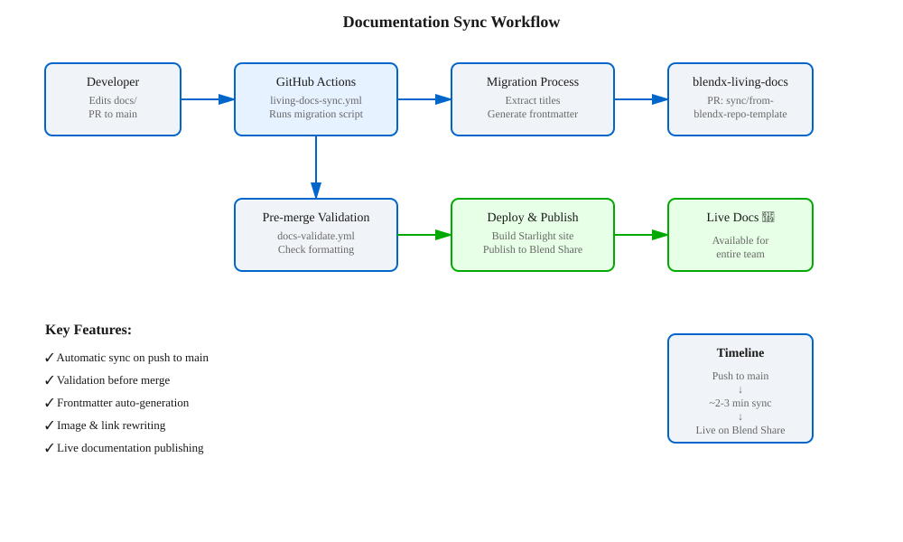

# Documentation Guidelines

All documentation in `docs/` is automatically synced to [blendx-living-docs](https://github.com/BLEND360/blendx-living-docs). Follow these guidelines to ensure your docs sync correctly.

See [blendx-repo-template](https://github.com/BLEND360/blendx-repo-template).

## File Organization

```
docs/
├── SYNC_DOCS_GUIDELINES.md    ← This file
├── features/             ← Feature documentation
├── guides/               ← How-to guides
├── architecture/         ← Architecture decisions
├── images/               ← ALL images MUST go here
└── reference/            ← API reference, configurations
```

Create subfolders as needed. All `.md` files in any subfolder will be synced.

## Required: H1 Heading

Every `.md` file must start with a single H1 heading. This is extracted as the document title:

```markdown
# My Document Title

Content goes here...
```

The H1 is used to generate frontmatter during sync. If missing, sync fails.

## Images: MANDATORY docs/images/ Folder

**CRITICAL:** All images MUST be placed in `docs/images/`. No exceptions.

### Correct

```markdown

```

### Incorrect (will break sync)

```markdown


```

Place image files:
```
docs/
└── images/
    ├── example.png
```

Then reference with `./images/filename`:

### Example Image



## Diagrams: Using Mermaid

Mermaid diagrams are supported for creating flowcharts, sequence diagrams, architecture diagrams, and more without managing image files:

```markdown
\`\`\`mermaid
graph TD
    A[Start] --> B[Process]
    B --> C{Decision}
    C -->|Yes| D[End]
    C -->|No| B
\`\`\`
```

### When to use Mermaid vs Images

| Use Mermaid | Use Images |
|------------|-----------|
| Flowcharts, sequences, diagrams | Screenshots, photos, mockups |
| Technical architecture | UI/UX designs |
| Decision trees, workflows | Complex visual layouts |
| Frequently updated content | Static reference materials |

### Common Diagram Types

**Flowchart:**
```markdown
\`\`\`mermaid
graph LR
    Start([Start]) --> Check{Check}
    Check -->|Pass| Success([Success])
    Check -->|Fail| Error([Error])
\`\`\`
```

**Sequence Diagram:**
```markdown
\`\`\`mermaid
sequenceDiagram
    Client->>API: Request
    API->>Database: Query
    Database-->>API: Result
    API-->>Client: Response
\`\`\`
```

**Architecture Diagram:**
```markdown
\`\`\`mermaid
graph TB
    Client[Client] --> LB[Load Balancer]
    LB --> API1[API Server 1]
    LB --> API2[API Server 2]
    API1 --> DB[(Database)]
    API2 --> DB
\`\`\`
```

### Benefits

- **No file management:** Diagrams live in the markdown
- **Version control:** Changes tracked in git
- **Easy updates:** Edit text instead of redrawing
- **Consistent styling:** Mermaid handles rendering

Learn more: [Mermaid Documentation](https://mermaid.js.org/)

## Links: Use Relative Paths

Links to other docs should use relative paths:

```markdown
[Getting Started](./guides/getting-started.md)
[Feature Overview](./features/overview.md)
```

External links use full URLs:

```markdown
[Read more](https://example.com)
```

## Code Blocks: Avoid H1 Syntax

Don't use `# ` in code blocks unless it's escaped or clearly commented. The migration script may get confused:

```markdown
# Good
\`\`\`bash
# This is a comment
echo "test"
\`\`\`

# Also good
\`\`\`bash
echo "This has a sharp: #"
\`\`\`
```

## Frontmatter (Auto-Generated)

Frontmatter is **automatically generated during sync**. You do NOT need to add it:

```yaml
---
title: My Document Title
description: Brief description extracted from first paragraph.
sidebar:
  order: 1
---
```

The migration script creates this from your H1 and content. Do not manually add it to source files.

## File Naming

- Use kebab-case: `getting-started.md`, `system-design.md`
- Avoid spaces and uppercase in filenames
- Be descriptive: `setup.md` not `doc.md`

## Content Tips

- Start with a brief summary paragraph (becomes description)
- Use clear H2/H3 headings for structure
- Keep lines under 100 characters when possible
- Use code blocks for examples
- Link to related docs

## Validation

Before pushing, run:

```bash
node scripts/validate-docs.mjs
```

This checks:
- ✅ H1 heading exists
- ✅ Images in `./images/` paths only
- ✅ Links are relative
- ✅ No H1s in code blocks (warnings)

## Common Issues

### Images don't appear after sync

**Check:** Image path uses `./images/` and file exists in `docs/images/`.

### Title extraction fails

**Check:** H1 heading exists at top of file, before any code blocks.

### Links break after sync

**Check:** Links use relative paths (`./<path>`) not absolute paths.
