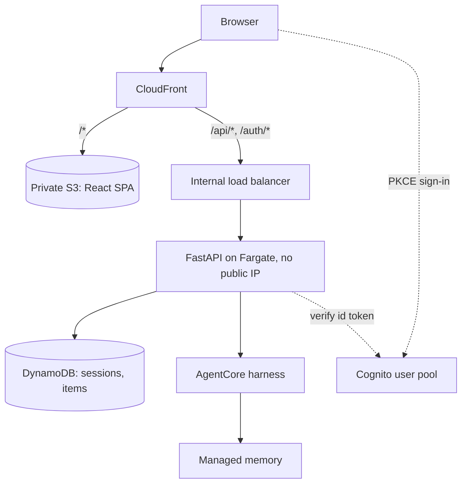
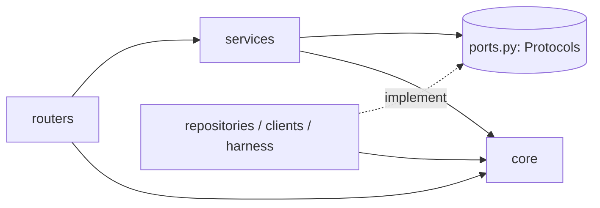
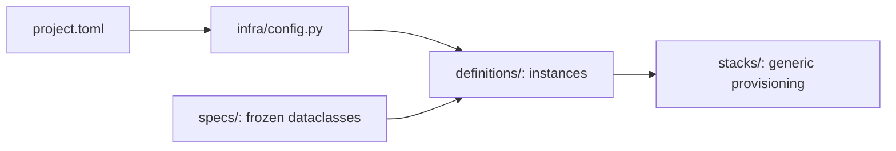

# Architecture

Technical reference for the topology, the layering rules and the decisions behind the BlendX AWS fullstack template: a modular monolith per environment, ports and adapters inside each service, delivered as a golden path whose rules CI enforces.

## Runtime topology

CloudFront is the only public entry. The API has no public IP: CloudFront reaches it through an internal load balancer, and the SPA lives in a private S3 bucket.

Because the SPA and the API share one origin, there is no CORS configuration anywhere. The SPA only calls relative paths (`/api/*`, `/auth/*`): the Vite dev server proxies them locally and CloudFront does it when deployed.

## Repository layout

| Path | Responsibility |
|---|---|
| `project.toml` | The only place names, account and region are written |
| `backend/api/` | FastAPI service; sibling services go next to it |
| `frontend/web/` | Vite + React SPA; sibling UIs go next to it |
| `contract/` | Neutral data pinning the SSE stream of a turn, read by both test suites |
| `harness/` | Starter harness (model + managed memory), deployed with the `agentcore` CLI |
| `infra/` | CDK app in Python: specs, definitions and generic stacks |
| `scripts/` | Setup, deployment and operations entrypoints that import `infra/config.py` |
| `.github/workflows/` | `ci.yml` and `deploy.yml` |

## One parameter, one source

`project.toml` is parsed and validated by `infra/config.py`, which derives every name: stacks, tables, roles, the harness and its outputs. Locally, `scripts/setup.py` renders `backend/api/.env` and `frontend/web/.env`. When deployed, the app stack injects the same variables into the ECS task. A test (`infra/tests/test_no_hardcoded_names.py`) fails if a resource name appears literally anywhere else.

## Backend layering

Direction is `routers → services → repositories | clients | harness → core`, and `uv run lint-imports` (contracts in `backend/api/pyproject.toml`) breaks CI on a violation:

- `routers/` parse, authorize and delegate. They never import boto3 or know a table name.
- `services/` decide. They never import FastAPI, Starlette or boto3, and reach the outside only through the `Protocol` ports in `services/ports.py`.
- `repositories/` (DynamoDB), `clients/` (other AWS services) and `harness/` (AgentCore) are adapters. They translate AWS errors with `core.errors.classify_aws_error`.
- `core/` is cross-cutting: typed config, errors, logging, middleware. Everyone may import it.

The `harness/` adapter is the anti-corruption layer: a change in the shape of AgentCore is a one-file change, and the business logic is testable with no credentials.

## Error contract

No text from a dependency ever reaches the client. Every error leaves the process as a fixed sentence plus a stable code `<dependency>_<category>` (`harness_unavailable`, `memory_throttled`, `data_conflict`, `tool_failed`, plus `validation_error`, `not_found`, `internal_error`). The real cause is logged against the request id. The error body is always `{ "error": { "code", "message", "retryable", "requestId" } }`.

## Infrastructure as data

Stacks are generic; resources are added by adding specs. See [infrastructure](./infrastructure.md) for the stack list and the extension table.

One stack per lifetime (roles, auth, data, harness, network, app) means an app rollback can never delete data.

## Trust boundary

The browser sends text, a session id, tool ids and a model, and nothing else is read. Harness ARN and endpoint, memory id, actor id, runtime session id, anything executable, session ownership and error text from AWS never appear in a request that is acted on or in any response. `tests/test_trust_boundary.py` reads the OpenAPI document and fails if a field names one of them. See [backend-api](./backend-api.md).

## Local-only shortcuts

Two switches exist for development and both are ignored inside ECS, detected through the task metadata endpoint rather than configuration: `LOCAL_AUTH_BYPASS` (serves a stand-in admin) and `HARNESS_REPLAY` (plays recorded streams). A deployed task logs a startup warning if they are set.

## Decisions and non-goals

- A single repository, not two: the backend/frontend dependency (bucket and CDN) is real and visible; independent deployments come from path filters.
- Microservices, full Clean Architecture, tactical DDD, CQRS and message buses were rejected for v1. Each remains a valid exit when its trigger appears, for example a queue when a turn must outlive the request that started it.
- Out of scope for v1: gateways, MCP tool runtimes, knowledge bases, evaluations and schedulers; relational databases; custom domains, WAF and autoscaling.
