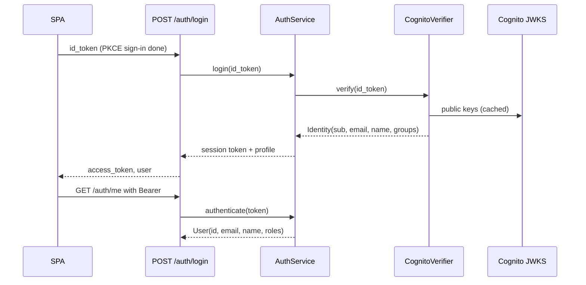

# Authentication

How sign-in works end to end: Cognito proves identity once, then the API issues its own short-lived credential that authenticated routes validate without network calls.

## Flow

Authenticated routes validate the API's own credential locally. Only `/auth/login` touches the JWKS.

## The session credential

A JWT signed with `AUTH_JWT_SECRET` (HS256) with claims `sub`, `email`, `name`, `roles`, `iat`, `exp` and `iss`, valid `AUTH_TOKEN_TTL_SECONDS` (3600 by default). Nothing about the session is persisted on the server and there is no silent refresh: when it expires the SPA signs in again. Rotating the secret invalidates active sessions.

Cognito's id token is verified with RS256 against the pool's public keys, checking signature, `iss`, `aud`, `token_use` and expiry. The algorithm is fixed on every decode, so there is no algorithm-confusion path. The secret must be at least 32 characters and the API refuses to start otherwise; `setup.py` generates one with `secrets.token_urlsafe`.

## Roles and groups

Cognito groups `admin` and `user` become the API's roles. Roles come from the signed credential, never from the request. Nobody can self sign-up; users are created with `scripts/create_user.py`.

## Errors

| Situation | HTTP | Code |
|---|---|---|
| Cognito token expired or wrong signature, `iss`, `aud` or `token_use`; own credential missing, expired, tampered or from another secret | 401 | `auth_invalid_token` |
| Required role missing | 403 | `auth_forbidden` |
| JWKS unreachable or Cognito not configured | 503 | `auth_unavailable` |

The client always receives a fixed message; the real reason is logged with the request id and never includes the token or the secret.

## Local development

`LOCAL_AUTH_BYPASS=true` serves authenticated routes as a stand-in admin and the SPA runs in local mode without sign-in. It is ignored inside ECS, detected through the task metadata endpoint. `deploy_auth.py` sets it to `false` and writes the Cognito values into both `.env` files; set it back to `true` to skip sign-in locally.

## Callback URLs

`http://localhost:5173/` is always allowed. `deploy_app.py` adds the deployed CloudFront URL (https, trailing slash) to `[auth].callback_urls` in `project.toml` and redeploys sign-in. To allow another address add it there and run `deploy_auth.py`.
