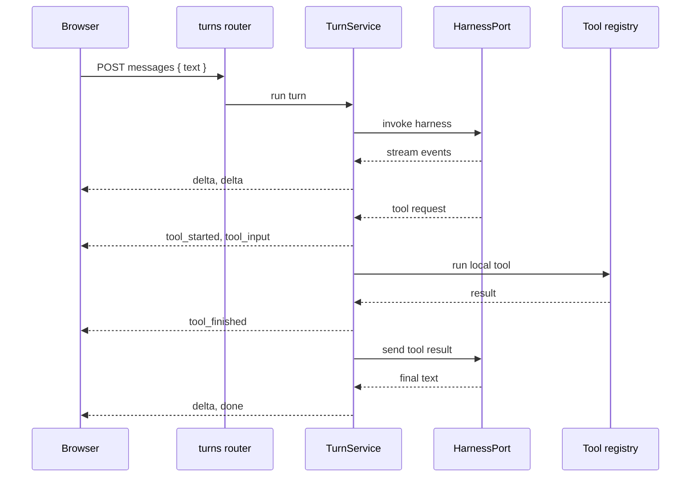
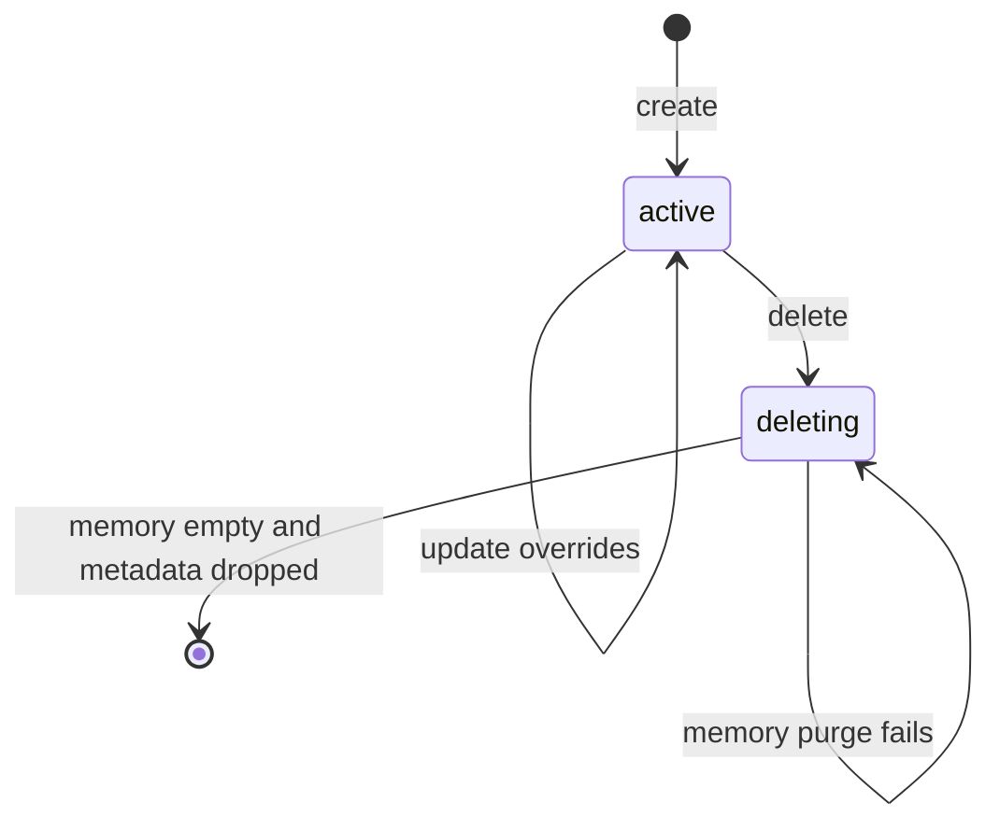

# Backend API

How the FastAPI service converses with an AgentCore harness: sessions, streamed turns, tools, limits, and how to extend it without leaving the pattern.

## Model

A user has sessions. Each session freezes a runtime configuration (a model and the tools the agent may call) when it is created. Sending a message opens a turn: the API invokes the harness and relays what the agent does to the browser as server-sent events.

| Route | Does |
|---|---|
| `POST /api/v1/sessions` | Create; body `{ modelId?, toolIds? }` |
| `GET /api/v1/sessions`, `GET /api/v1/sessions/{id}` | List the caller's sessions; read one |
| `PATCH /api/v1/sessions/{id}` | Change model or tools. Omit a field to keep it; `null` returns to the default frozen at creation |
| `DELETE /api/v1/sessions/{id}` | Empty the harness memory, then drop the session. If the memory cannot be emptied the session stays hidden and the same call finishes the job |
| `GET /api/v1/sessions/{id}/messages` | The conversation, read from the harness memory |
| `POST /api/v1/sessions/{id}/messages` | Body `{ text }`; the response is `text/event-stream` |
| `GET /api/v1/configuration` | What the deployment decides (models, `replayMode`) |
| `/api/v1/items` | Example CRUD resource, in memory locally and DynamoDB when deployed |
| `POST /auth/login`, `GET /auth/me` | Trades a Cognito id token for the API's session credential; reads the signed-in profile |
| `/health`, `/api/health`, `/ready` | Liveness, public liveness through CloudFront, dependency readiness |

## The turn stream

`event:` is the name and `data:` is JSON in camelCase. The vocabulary is closed, see [sse-contract](./sse-contract.md).

| `event` | `data` |
|---|---|
| `delta` | `{ text }` |
| `tool_started` | `{ callId, toolId, label }` |
| `tool_input` | `{ callId, input }` |
| `tool_finished` | `{ callId, status: "success" or "error", result }` |
| `done` | `{}` |
| `error` | `{ code, retryable, requestId }` |

Every stream ends with exactly one `done` or one `error`. Anything refused before the stream opens (unknown session, empty message, no harness configured) is an ordinary JSON error with its status code.



## Sessions and storage

The session is the only aggregate. Its identity is a server-generated `session_id`; the owner always comes from the signed-in user, never from the request, and the store keys records by `(owner_id, session_id)`, so another user's session is indistinguishable from a missing one. Conversation content is never stored on the record: it lives only in the harness memory. `update` is guarded by a `revision` that grows by one on every write, and a stale write fails with `data_conflict`.



`deleting` hides the session from lists and reads, but a new `DELETE` finds it and resumes the purge. Sessions and items live in memory locally (`InMemorySessionStore` with a lock and identical semantics, including the revision check) and in DynamoDB when deployed. A message is limited to 12000 characters to bound the cost of a turn.

## Tool round trip with the harness

When the agent requests a local tool the service runs it and sends the harness an assistant `toolUse` message plus a user `toolResult` message under the same runtime session id. The result goes as JSON text, because the harness runtime rejects a `{json: ...}` content block. The response stream begins with an echo of the `toolResult` that was sent; the service ignores results it answered itself so they are not announced twice. If the client disconnects the turn is cancelled and the boto stream closes.

## Add a tool

A tool is one entry in `TOOLS` in `app/tools/builtin.py`: an id, a label shown while it runs, a description for the model, a pydantic model for its input and a function.

```python
class Lookup(BaseModel):
    order_id: int

def lookup_order(arguments: Lookup) -> dict:
    return {"state": orders.state(arguments.order_id)}

TOOLS.append(Tool(id="lookup_order", label="Looking up the order",
                  description="Finds an order's state.", input_model=Lookup, handler=lookup_order))
```

The model's JSON schema is what the harness sees and the same model validates what the agent sends back. A tool never raises to the turn: bad input, an exception or an unknown tool become a `tool_failed` result the agent can react to, and the browser receives a redacted result (over 16 KB is replaced by `{ "truncated": true }`). New sessions get every registered tool; existing sessions keep the list they were frozen with.

## Add an event type

Changing the vocabulary is deliberate and breaks tests on purpose: the dataclass, the `TurnEvent` union and `TURN_EVENT_NAMES` in `app/core/models.py`; the emission in `app/services/turn.py` (serialization needs no change); the pinned tests; and the shared fixture. The four places are listed in [sse-contract](./sse-contract.md).

## What never crosses to the client

A client sends text, a session id, tool ids and a model. These never appear in an acted-on request or in any response or event:

- the harness ARN and endpoint, the memory id, the actor id, the runtime session id
- anything executable (a tool function, a skill URI)
- session ownership (it comes from the signed-in user) and its revision
- error text from AWS or from a tool, stack traces, account ids

## Point the app at an existing harness

Set `harness.arn` and `harness.endpoint` in `project.toml`, list the allowed models in `harness.model_ids`, run `python scripts/setup.py`; the backend reads them as `HARNESS_ARN` and `HARNESS_ENDPOINT`. No code changes. The task role needs `InvokeHarness` and `GetHarness` on the harness and `ListEvents` and `DeleteEvent` on its memory; the statements live in `infra/definitions/roles.py` (`invoke_harness`, `get_harness`, `harness_memory`) and `AppStack` attaches them.

Known limitation: not tested against a harness that has tools of its own. When a session has local tools the call sends a `tools` list, which AgentCore documents as overriding the harness's own tools; with no local tools nothing is sent.

## Behind CloudFront

A turn can be silent while the agent thinks, and CloudFront closes a connection after 60 seconds without a byte (the origin response timeout `AppStack` sets). `EventSourceResponse` writes a `: ping` comment whenever the stream has been idle for 15 seconds, which a client does not see as an event. `tests/test_sse_keepalive.py` pins both facts, so a FastAPI upgrade that changes either fails CI.

## Timeouts and retries

`HARNESS_IDLE_TIMEOUT_SECONDS` (300) is the longest the harness may stay silent (botocore's read timeout): a turn that keeps producing events is never cut, one that goes quiet is hung and ends with a retryable `harness_unavailable`. `HARNESS_TURN_TIMEOUT_SECONDS` (900) bounds the whole agent loop. `MAX_TOOL_ROUNDS` (8) bounds local-tool round trips before `tool_failed`. The invocation is never retried automatically: it is not idempotent and a retry would write the user's message to memory twice. The `retryable` flag tells the client whether to offer a retry.

## Replay and test doubles

`HARNESS_REPLAY=true` plays recorded streams through the same translator as the real harness (`app/harness/replay.py`, a `HarnessPort`). Recordings live in `app/harness/fixtures/`: `real_text_only` and `real_tool_call` were recorded from a deployed starter harness; `text_only`, `tool_call`, `managed_tool`, `bad_tool_input`, `marker_split` and `fails_midstream` are synthetic, built from the AgentCore service model because a starter harness cannot produce them. The test suite replays them with in-process stand-ins for memory and stores, so `uv run pytest` needs no credentials and `conftest.py` points credentials at nothing so an accidental real call fails.
