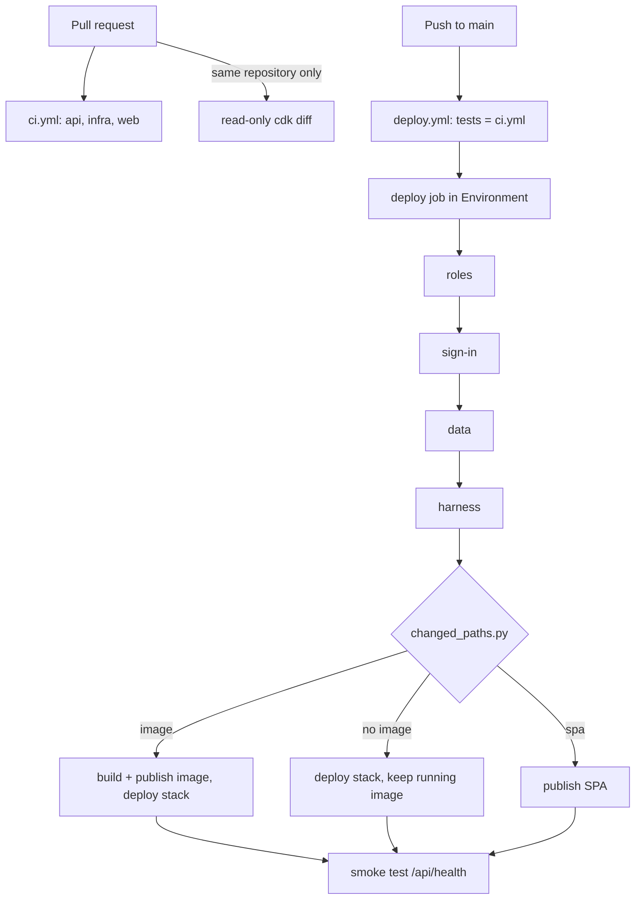

# CI/CD

How GitHub Actions checks pull requests and deploys from `main` with OIDC and no long-lived AWS keys, and the manual setup it needs once.

## Workflows

`ci.yml` runs on pull requests and is reusable. `deploy.yml` runs on push to `main` (after CI succeeds) or by manual dispatch choosing `dev` or `prod`.

### CI jobs

| Job | Runs |
|---|---|
| `api` | `uv run lint-imports`, `uv run pytest -q`, and a Docker build of the image |
| `infra` | `uv run pytest -q` (stack synthesis and assertions) |
| `web` | typecheck, `npm test`, the neutral-brand suite, `check:boundaries`, build |
| `diff` | `scripts/diff.py`: `cdk diff --method=template`, no change sets. Same-repository PRs only; forks run the checks without AWS access |

There are no path filters, so every job runs on every PR, which includes any change in `contract/`. If you add filters, include `contract/**`. The harness CDK tests under `harness/agentcore/cdk/test/` are not run by CI.

### Deploy job

The deploy job reuses the same Python scripts you run locally rather than repeating the logic in YAML: `bootstrap.py --roles-only`, `deploy_auth.py --stack-only`, `deploy_data.py`, `deploy_harness.py`, then `changed_paths.py` compares HEAD with the commit running in ECS to decide whether to rebuild the image and republish the SPA. The image tag is `<sha>-<run_attempt>`. A final `smoke_test.py` calls `/api/health` through the public CloudFront URL. `/health` is deliberately not used: it does not pass through CloudFront, and the SPA fallback would answer 200 even with the API down. Concurrency is serialized per environment and never cancelled mid-run.

If the deploy changes `project.toml` (the first deployment adds the CloudFront URL to `[auth].callback_urls`), the last step fails and prints the diff: commit it and rerun.

## Trust model

- The deploy role trusts only the Environments declared in `project.toml` and `refs/heads/main`.
- The PR role is read-only: it can read the project's deployment inputs and assume only CDK's lookup role. It cannot deploy or publish.
- No AWS access keys belong in GitHub secrets.
- Until a separate AWS account per environment is supported, every configured Environment must point to the account in `project.toml`.

## One-time setup

1. Authenticate locally and confirm `aws sts get-caller-identity` matches `project.toml`.
2. Run `uv run --project infra python scripts/bootstrap.py`. It bootstraps CDK, creates the OIDC provider if needed, deploys the roles and prints the `gh variable set` commands; review each ARN and region.
3. In **Settings → Environments** create `dev` and `prod`. Allow deployments from `main` only; require reviewers for `prod` and none for `dev`.
4. Repository variables: `AWS_DIFF_ROLE_ARN` and `AWS_REGION`.
5. Per Environment variables: `AWS_DEPLOY_ROLE_ARN` and `AWS_REGION`.
6. Protect `main` with a ruleset: require pull requests and the `api`, `infra` and `web` checks; no bypassing direct pushes.
7. Push to `main` or dispatch `deploy.yml` for `dev`; inspect the CI, OIDC, ordered deploy and smoke test. Use `prod` only after `dev` succeeds and the reviewer approves.

Creating the Environments and protecting `main` are manual steps in the GitHub interface and are not automated by the template.
